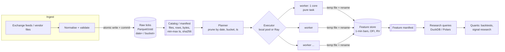

# exaflow: a market-data research platform designed for exabyte scale

A working, benchmarked reference implementation of the storage and compute
architecture a systematic trading firm uses for its research data: tick data in,
research-ready features out, with queries that touch a tiny fraction of the store.

It runs on a laptop at hundreds of millions of ticks. **The same code and
layout** run on a Ray cluster against object storage. The scale model
(`bench/SCALE_MODEL.md`) turns measured per-core throughput into the cluster
you'd need for 1 EB.

```
python3 -m venv .venv && source .venv/bin/activate
pip install -r requirements.txt
./run_demo.sh small       # ~20M trades, seconds
./run_demo.sh medium      # ~375M trades, ~2.5 GB, ~2 min on 2 cores
./run_problems.sh         # three trading problems, recreated and fixed (~30 s)
python3 -m pytest tests   # correctness: chaos == clean, bars reconcile to ticks
```

Data and results are deterministic: `./run_problems.sh` printed identical numbers on a
MacBook in Manila and a cloud VM on US time. (Speed numbers naturally vary by machine.)

## Architecture



### Design decisions (and why they matter at an exabyte)

| Decision | Here | At 1 EB |
|---|---|---|
| **Columnar + compressed storage** | Parquet, zstd, delta-encoded, 6.8 B/trade | Storage cost and I/O are the bill; columnar reads touch only needed columns |
| **Partition key = compute key** | `(date, symbol-bucket)` | Bar/feature jobs need no shuffle, the most expensive operation in distributed compute |
| **Hash-bucketed symbols** | blake2b(symbol) % N | Spreads Zipf-skewed liquidity so one hot name doesn't make a straggler partition |
| **Catalog, never LIST** | JSON-lines manifest with stats | ~2B files; LIST is millions of API calls. Becomes an Iceberg-style metadata tree |
| **Metadata-level pruning** | prune on date/bucket/ts before reading | Research queries touch MB–TB, not EB |
| **Exact arithmetic for sums** | notional summed as integers (price × 10,000) | Float sums depend on addition order; integers make retries bit-identical, not just close |
| **Pure, deterministic tasks** | same input + seed → same bytes (sha-verified) | Safe retries, speculative execution, reproducible research |
| **Atomic publish, driver-only commit** | temp + rename; manifest append | Crashed workers never leave partial datasets; exactly-once output |
| **Resumable** | skip tasks already in output manifest | A week-long backfill survives node loss without restarting |
| **Backpressure** | bounded in-flight window on Ray | You can't submit 2B tasks at once; the scheduler would fall over |
| **One core per worker** | `POLARS_MAX_THREADS=1` | Makes per-core throughput the unit you can multiply |

## Measured results

### 10-core MacBook Pro (Apple Silicon, 32 GB): scaling

200M trades, v1 engine (Polars hash group-by), single run per setting:

| Workers | Time | Speed-up | Efficiency |
|---|---|---|---|
| 1 | 14.3 s | 1.00× | 100% |
| 2 | 6.9 s | 2.07× | 103% |
| 4 | 3.7 s | 3.92× | 98% |
| 6 | 2.6 s | 5.58× | 93% |
| 8 | 2.1 s | **6.80×** | **85%** |
| 10 | 2.1 s | 6.96× | 69% |

Near-linear to 8 workers. The curve flattens past 8, where the remaining cores
add little.

### 2-core cloud VM: full demo, current (v2) engine

| | |
|---|---|
| Dataset | 375M trades, 500 symbols × 15 days, **2.55 GB** compressed (6.8 B/trade), 240 partitions (measured before the UTC/arrival-time generator fix) |
| Throughput | **17–19M trades/s per core** (best 18.8M); 33.5–37M trades/s on 2 cores |
| Scaling 1→2 workers | 1.97× (99% efficiency) |
| Chaos run | ~20% of tasks crashed on purpose and were retried. Output identical to the clean run on every run |
| Same job on Ray | 16.5M trades/s on 2 cores with 50 injected failures, output identical. Ray's own processes compete for the 2 cores here |
| Point query (1 symbol-day) | 1 file of 240, 0.73% of the data |
| Capacity model | ~218 × 64-core nodes to process 100 quadrillion trades in 7 days (70% efficiency assumed) |

Full numbers: `bench/SCALE_MODEL.md` after `./run_demo.sh medium`.

## Performance work (profile → fix → verify)

| Change | Why it's faster | Effect |
|---|---|---|
| Fixed-point prices (`price_e4`, int64) + delta encoding for sorted `ts`/price | Stores the small step between neighbours, not full 8-byte values | **12.4 → 6.8 B/trade (−45% storage)**, faster decode |
| Sorted-run NumPy kernel replaces hash group-by | Rows are sorted by (symbol, ts), so each bar is a contiguous run → one sequential pass with `reduceat`, no hash table | Aggregation step **5.6× faster** |
| Integer sums, one shared float conversion | Polars' `x / 10_000` multiplies by the reciprocal (last-bit differences); NumPy does true division | Both engines bit-identical |
| Biggest partitions scheduled first | Avoids one large task finishing alone while other cores idle | Shorter tail on many-core runs |

End to end on the 2-core VM: **12.0M → 18.8M trades/s per core (1.57×)**. About 55% of
the remaining time is Parquet decode; the next lever is a compiled reader.
`--engine polars` keeps the v1 reference implementation; the tests assert both
engines produce identical output.

## Three trading problems, recreated and fixed

`./run_problems.sh` (about 30 s) breaks each one on purpose, measures the damage,
then shows the fix. Faults and effects are planted with known answers, so every
fix is scored against the truth, not eyeballed. Results: `demo_results/*.json`.

### 1. Bad data gets into signals: `exaflow/quality.py`

A dirty feed (0.2% bad rows: fat-finger prices, duplicates, zero/negative sizes,
off-hours trades, plus out-of-order delivery) goes through a quality gate before
it gets a catalog entry. Bad rows are quarantined with a reason, order is
repaired, and partitions over the bad-row limit are rejected.

| 20M trades, 39,975 bad rows | No gate | With gate |
|---|---|---|
| Minute bars with wrong values | 41,620 | **0** |
| Fake 5% one-minute moves (true count: 0) | 254 | **0** |
| Worst high-price error | 900% | **0%** |
| Peak volatility vs truth | 397× | **1×** |
| Bad rows caught | none | **39,975 of 39,975** |

With the gate, every bar matches the true data exactly.

### 2. Research data isn't point-in-time: `catalog.py` snapshots + `panel.py`

Synthetic market of 1,500 stocks over 5 years, 458 delisted (mostly failures).

| Annual return | Survivors only | Point-in-time | Overstated by |
|---|---|---|---|
| Equal-weight all stocks | 9.8% | 2.7% | **+7.1 pts** |
| Buy last month's losers | 31.9% | 12.9% | **+19.0 pts** |

The catalog now keeps every commit as a snapshot. A data correction is a new
file version; old versions stay. After the vendor restated 2,886 rows, a rerun
on latest data changed the result, while a rerun pinned to the original
snapshot (`read_panel(root, as_of=snapshot)`) reproduced it exactly.

### 3. Research ignores trading costs: `exaflow/backtest.py`

Cost model: half the bid-ask spread plus square-root market impact,
`Y * sigma * sqrt(trade / daily volume)`. A 5-day reversal strategy, $10M fund:

| | Annual return | Sharpe | Costs / yr |
|---|---|---|---|
| On paper (no costs) | +24.6% | 10.7 | 0% |
| Same strategy, real costs | **-19.6%** | -8.5 | 44.2% |
| Cost-aware: liquid stocks only, move halfway to target daily | **+3.2%** | 1.4 | 5.9% |

The naive version loses money at every fund size; the cost-aware version's
capacity (where net return hits zero) is about **$49M**.

### Bugs these demos caught along the way

- The generator used the computer's local time zone, so the same command gave
  different data in Manila and Los Angeles. Session times are now pinned to UTC.
- The fault injector's overlapping row swaps duplicated one genuine trade and
  dropped another. The gate correctly flagged the copy; the injector was fixed.
- Duplicate detection only compared neighbouring rows, so 1 duplicate in 10,005
  slipped through when another bad row sat in between. It now catches any repeat.

## Honest limits

- The bars workload is light. Heavier features (cross-sectional regressions,
  order-book reconstruction) cost more per byte, so redo the scale model with
  that workload's measured throughput.
- Local disk, not object storage. On S3/GCS, per-request latency means you
  want larger files (the model assumes 512 MB) and parallel range reads.
- The manifest is single-writer. A production catalog (Iceberg/Delta on a
  transactional store) gives concurrent writers and snapshot isolation.
- Synthetic data. The shape (Zipf liquidity, Poisson arrivals, random-walk prices)
  is realistic enough for systems work, not for alpha research.

## Layout

```
exaflow/catalog.py      manifest, pruning, stable hash bucketing
exaflow/executor.py     local process pool / Ray, retries, backpressure
exaflow/generate.py     deterministic synthetic tick generator
exaflow/pipeline.py     ticks -> 1-min bars (OHLCV, VWAP, OFI, returns, RV30), chaos mode
exaflow/kernels.py      sorted-run NumPy aggregation kernel (the fast engine)
exaflow/quality.py      quality gate: fault injection with ground truth, detection, quarantine
exaflow/panel.py        daily equity panel with listings, delistings and liquidity
exaflow/backtest.py     cross-sectional backtester with spread + square-root impact costs
demos/                  break-it / fix-it demos for the three trading problems
compare_outputs.py      row-for-row comparison of two outputs (exit 1 if different)
exaflow/query.py        research queries + bytes-touched measurement
exaflow/scale_model.py  measured throughput -> exabyte compute & storage plan
tests/                  exactly-once under failure, reconciliation, determinism
```

Distributed run: `pip install "ray[default]"`, then `--backend ray` (local
mini-cluster), or set `RAY_ADDRESS` to join a real cluster.

## License

MIT
